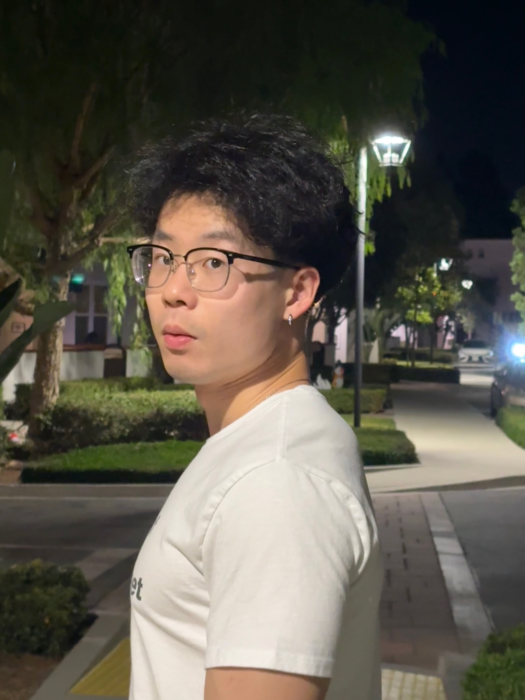

<h1 class="title">Youzhe Liu</h1>

## About

Hi! I am Youzhe Liu (刘有哲). Right now, I am a final year Ph.D. student at University of California, Riverside, advised by Professor [Yihan Sun](https://www.cs.ucr.edu/~yihans/) and [Yan Gu](https://www.cs.ucr.edu/~ygu/). I got my B.S. in Data Science from [Fudan University](https://www.fudan.edu.cn/en/). **I am seeking industry research and engineering positions starting in 2027.**

## Research

My current research focuses on designing **parallel algorithms and data structures**, with both theoretical guarantees and practical implementations. I also work on **model training acceleration** and **RL training infrastructure**. 

## Selected Publications
- [Toggle Tree: A New Data Structure for Efficient Parallel Graph
Processing](https://alanliu.site) *with Xinjian Jiang, Yan Gu, and Yihan Sun. PPoPP 2027* 

- [Parallel k-Core Decomposition: Theory and Practice](https://www.arxiv.org/abs/2502.08042) *with Xiaojun Dong, Yan Gu, and Yihan Sun. SIGMOD 2025* [[code](https://github.com/ucrparlay/Parallel-KCore)] [[talk](https://youtu.be/eU0YPJNneNI)] 

- [Efficient Parallel Output-Sensitive Edit Distance](https://www.cs.ucr.edu/~yihans/papers/2023/ESA23/edit-distance.pdf) (**best paper award**). *with Xiangyun Ding, Xiaojun Dong, Yan Gu, and Yihan Sun. ESA 2023*. [[code](https://github.com/ucrparlay/Edit-Distance)] [[talk](https://drive.google.com/file/d/1-cgW8-c2MJ1ppC20bLyRS0M8KFjACZRX/view?usp=drive_link)]

## Working Experience 

June 2026 - Sep. 2026, **ByteDance Seed**, San Jose, CA, with [Ziyun, Wei](https://ultra-seven.github.io/), [Wang Zhang](https://scholar.google.com/citations?user=h4VxTNUAAAAJ&hl=zh-CN), and [Haibin Lin](https://sites.google.com/view/haibinlin/?pli=1&authuser=0). 
**Working on RL post-training infrastructures.**

June 2025 - Sep. 2025, **ByteDance**, San Jose, CA, with [Celong Liu](https://scholar.google.com/citations?user=WJSj6FUAAAAJ&hl=en). 
**Designing a pipeline parallel training framework with fault tolerance.**

Sep. 2021 - Dec. 2021, **Microsoft**, Shanghai, China. 
**Working on Visual Studio Code.**

## Teaching

UC Riverside: CS190 (Spring '23), CS142 (Winter '24), CS141 (Fall '24, Winter '26), CS214(Fall '23, Spring '25), CS218 (Spring '25), CS 152 (Spring '25, Fall '25)

## Services
- Committee member: FCPC'25
- Reviewer: JPDC'24, ALENEX'24, EURO-PAR'25, JPDC'26
- Subreviewer: SPAA'23, HiPC'24, ESA'24, PPoPP'25, SIGMOD'26
- Artifact Evaluation Committee: ALENEX'25, ALENEX'26

## Contact

- Email: youzhe.liu [at] email [dot] ucr [dot] edu
- GitHub: https://github.com/alanSquirrelyz
<!-- - Instagram: https://www.instagram.com/alan_squirrel/ -->
<!-- ## Misc
The [Play](https://open.spotify.com/playlist/0B1IJqA5cwUlusD6Kfr2ZN?si=71b3de964a5a4ea1)[lists](https://open.spotify.com/playlist/7APYv0SnF5VycR0VMpOjzy?si=b81226f11f614f5f) I am listening to. -->
